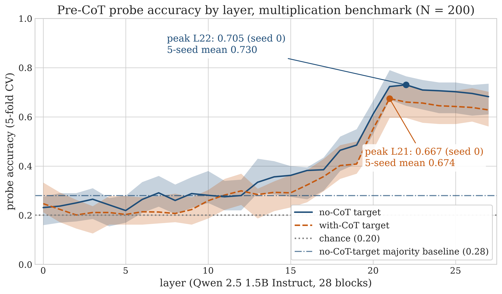

# cue-channels: does a 1.5B model know its answer before it reasons?

I tested whether Qwen 2.5 1.5B Instruct has already settled on a multiple-choice answer, in its activations, before it
writes a chain of thought (CoT). I used generated two-digit multiplication (a × b with a, b in 10–20, five options).
CoT really matters on this task: accuracy is 0.740 without CoT and 0.985 with it. A linear probe on the residual stream
at the last prompt token predicts the model's answer at 0.705 (majority baseline 0.280, p = 0.001). But four
pre-registered follow-ups, including a steering experiment, failed to show that the model uses that signal. So the
answer can be read out before the CoT starts. I could not show that it has been decided.

**Full write-up:** [`writeup/writeup.md`](writeup/writeup.md) (methods, all five nulls, appendices with every pre-registration SHA).

This is a single-author project: 17 experiments, the 13 from E onward pre-registered in git before their data
existed, and one headline result that reproduces from a fresh clone in about 25 minutes.

## Headline result (experiment H2, N = 200)



| | No-CoT target (the model's answer without CoT) | With-CoT target (its final answer after CoT) |
|---|---|---|
| Peak layer, accuracy (seed 0) [95% CI] | L22, **0.705** [0.645, 0.765] | L21, **0.667** [0.596, 0.727] |
| 5-seed mean ± SD | 0.730 ± 0.019 | 0.674 ± 0.013 |
| Baseline | majority class 0.280 | chance 0.200 |
| Same probe on Gaussian noise | 0.246 | 0.236 |
| Max-over-layers permutation test | p < 0.01 (registered, 100 perms); p = 0.001 (post hoc, 1,000 perms) | same |

Both targets stay near baseline up to layer 19 and jump at layers 20–21. The probe reads the model's answer, not the
correct one. On the 52 items the model gets wrong without CoT, it recovers the model's wrong letter 61.5% of the time
and the correct letter 26.9% of the time. The result replicates on times tables (a, b in 2–12): 0.780 at layer 21
against a 0.230 majority baseline.

For the full methodology, the per-position analyses and the detail behind each null, read [`writeup/writeup.md`](writeup/writeup.md).

## Two methodology errors I caught, and what changed afterwards

**The letter-bias trap (experiment E).** My first pre-registered layer sweep, on a BIG-Bench Hard logic task, gave a
probe accuracy of 0.731. Then I computed the majority baseline. The model answered "B" on 77% of items, so a classifier
that always says "B" scores 0.769. The model was at chance on the task itself. My probe was decoding a letter
preference, not a decision. Since then, every probe accuracy in this repo is reported next to the majority-class rate
of its labels, and next to the same probe trained on noise. With five options, chance (0.20) is the wrong comparison.

**The distractor leak (experiment H → H2).** My first positive multiplication run passed every pre-registered check
and was still flawed. I had generated the wrong options as the correct answer ±1, ±2 or ±10, so the right answer was
the one value the other four were offset from. That rule finds the answer on 200/200 items without reading the
question. The symptom was a probe peaking inside the option list (0.835 at the token that starts option E, against
0.665 at the last prompt token). I rebuilt the distractors as other products from the same range. I also added an
**options-only baseline** to every pre-registration from then on: a classifier that sees only the five option values,
the best of logistic regression, a random forest and two hand-written rules
([`scripts/h2_pattern_baseline.py`](scripts/h2_pattern_baseline.py); full spec in Appendix D of [`writeup/writeup.md`](writeup/writeup.md)). It scores
1.000 on the old distractors and 0.206 on the new ones (chance 0.20). The headline survived the fix (0.695 → 0.705),
and the option-list peak went away.

## What this does not show

Each of these was pre-registered with a decision rule. None came back supported.

- **Causal steering (J): null.** Adding a contrastive "answer A" vector at layer 22 left the share of "A" answers at
  0.230 for every α in {−2, −1, +1, +2, +5}. Even at α = +20 on every token, about 64% of the residual norm and enough
  to drop accuracy to 0.74, the model did not shift toward A (0.200).
- **Mid-CoT decay (M): registered verdict "signal was always noise".** The layer-22 probe falls below the majority
  rate from the first generated CoT token (0.62 → 0.16). Probes retrained at each position (post hoc) drop to the
  majority rate during the written arithmetic and come back after the product appears.
- **Option reversal (N): mixed.** When I reversed the option order, the probe's peak position tracked the correct
  option with R² = 0.29, below the 0.6 threshold I had set for content tracking.
- **Per-token sweep (K): not confirmed.** Neither task's best token position beat the other's by the registered
  0.10 margin (0.04 and 0.085).
- **Unit conversions (I3): not supported at the last token.** The probe reaches 0.465, below its registered bar.
  The answer is readable earlier in the prompt (0.755 at the option-E token) but not at the last token.

I fit a "readable but not committed" story to the post-hoc data, but that is a hypothesis, not a result. An
epiphenomenal correlate, a code that changes with position, or a probe that simply reads the written product would
all fit the same data.

## Methods

For each item I cache residual-stream activations at all 28 layers (hidden size 1536) at the last prompt token and fit
a standardized multinomial logistic regression (sklearn, L2, C = 0.1 fixed in advance) with 5-fold cross-validation,
so every item gets an out-of-fold prediction. 95% CIs come from 2,000 bootstrap resamples of per-item correctness.
Each layer is repeated over 5 seeds; seed-to-seed SD is 0.005–0.046 across layers. I pick the peak from 28 layers, so
significance comes from a max-over-layers permutation test (100 permutations registered, 1,000 rerun post hoc; null
maximum 0.380). A post-hoc C sweep gives 0.705–0.715 at layer 22 for C in {0.1, 1, 10}. Positive controls (facts
written in the prompt) decode at 0.93–1.00. The paper-length version is [`writeup/writeup.md`](writeup/writeup.md).

## Pre-registration

For every main experiment, the hypothesis, gates and decision rules sit in
`experiments/<letter>_<name>/preregistration.md`. That file was committed before any of the experiment's data, and
`git log` shows each pre-registration commit ahead of its results commits. [`MAPPING.md`](MAPPING.md) lists both SHAs
for every experiment. Analyses I added afterwards are labelled post hoc or exploratory. No history has been rewritten.

## Reproduce the headline result

Tested on macOS (Apple M4 Pro, 24 GB, MPS) with Python 3.14.5. CUDA and CPU go through the same backend but were not
used for the committed results.

```bash
git clone git@github.com:CCaptainX/cue-channels.git && cd cue-channels
```

```bash
make setup          # project-local .venv from requirements.txt; `make setup-exact` uses the full lock file
```

```bash
make test           # fast tests, no model download
```

```bash
make reproduce-h2   # same as: bash scripts/reproduce_h2.sh results/h2_repro
```

`make reproduce-h2` downloads `Qwen/Qwen2.5-1.5B-Instruct` (about 3 GB) from Hugging Face on first use; no token is
needed. It then runs the options-only baseline, generates the 200 items, runs the model with and without CoT, caches
activations at all 28 layers, fits the probes (5 seeds × 5 folds), runs the permutation test, and checks the output
against the committed `experiments/H2_distractor_fix/metrics.json` with `scripts/compare_h2.py`. It takes about 25
minutes and writes only to `results/` (git-ignored).

```bash
make figures        # rebuild writeup/figures/ (300 dpi) from committed metrics
```

On 2026-10-24 I ran this from a fresh clone in a new venv, with the weights already cached. It finished in 22 minutes
and matched the committed results exactly: behavior (0.740 / 0.985), peak layers (22 / 21), seed-0 accuracies
(0.705 / 0.667), 5-seed means (0.730 / 0.674), verdicts, and the options-only baseline (0.206, and 1.000 on H's
distractors). Behavior and the baseline are deterministic (greedy decoding, fixed seeds). Probe accuracies can drift
slightly across hardware or library versions, so `compare_h2.py` accepts differences within the measured seed-to-seed
SD (up to 0.046) and requires the verdicts to match.

Every other experiment has a "Reproduce" block in its `experiments/<letter>_<name>/README.md`. J and M reuse H2's
activations; pass `--h2-dir results/h2_repro`.

## Repo layout

```
src/cue_channels/      model backend (models.py), config, probe training (probes/train.py)
scripts/               one entry point per experiment step; shared helpers f_common.py (prompts, parsing),
                       h_arith.py (multiplication items), run_full_f_protocol.py (the probe protocol);
                       h2_pattern_baseline.py (options-only baseline); reproduce_h2.sh + compare_h2.py
experiments/<X>_*/     per experiment: preregistration.md, pilot and metrics JSON, generations, figures, README
                       (activation pickles are regenerated, not committed)
writeup/               long-form write-up (writeup.md), make_figures.py, figures/
tests/                 `make test` (fast); `make test-slow` downloads weights
scratch/               exploration not used in the results (see scratch/README.md)
MAPPING.md             experiment letters → names, directories, pre-registration and results SHAs
```

The write-up itself is [`writeup/writeup.md`](writeup/writeup.md).

All commits are authored by the project's GitHub identity, CCaptainX
(`167642035+CCaptainX@users.noreply.github.com`). Nothing in the main results needs a gated model or an `HF_TOKEN`.

## Status and limitations

The project is complete as a scoped case study. It covers one model (Qwen 2.5 1.5B Instruct), one task family (two
multiplication item sets), one steering construction (18 vs 182 items, one letter, one layer), and no other model
families. No causal intervention came back positive, and I did no activation patching. The held-out sets are small
(100–200 items, CIs about ±0.06–0.10). With CoT the model is right 98.5% of the time, so for that target I cannot
separate "the eventual answer" from "the correct answer".

If I continue, the next steps are: run Cox et al.'s tasks through this pipeline and this task through their protocol,
on the same model; try probe-weight and per-letter steering directions; and pre-register tests that separate the three
alternatives above, for example patching the written product mid-CoT to see whether the retrained probe follows it.

## Related work

- **Cox, Kianersi & Garriga-Alonso (2026)**: pre-CoT answers decodable and steerable on mostly post-hoc binary tasks.
  This repo is a scoped counterpoint on a task where the CoT does work.
- **Lanham et al. (2023)**: behavioral CoT faithfulness tests via truncation and corruption.
- **Turpin et al. (2023)**: biasing cues change answers without being mentioned in CoT.
- **Chen et al. (2025)**: reasoning models often fail to verbalize the hints they use.
- See also: Kudo et al. (2026) on answers computed during arithmetic CoT; Jia & Mu (2026) on CoT becoming
  load-bearing as difficulty rises; Pfau, Merrill & Bowman (2024) on filler tokens standing in for CoT.

Full references are in [`writeup/writeup.md`](writeup/writeup.md).
